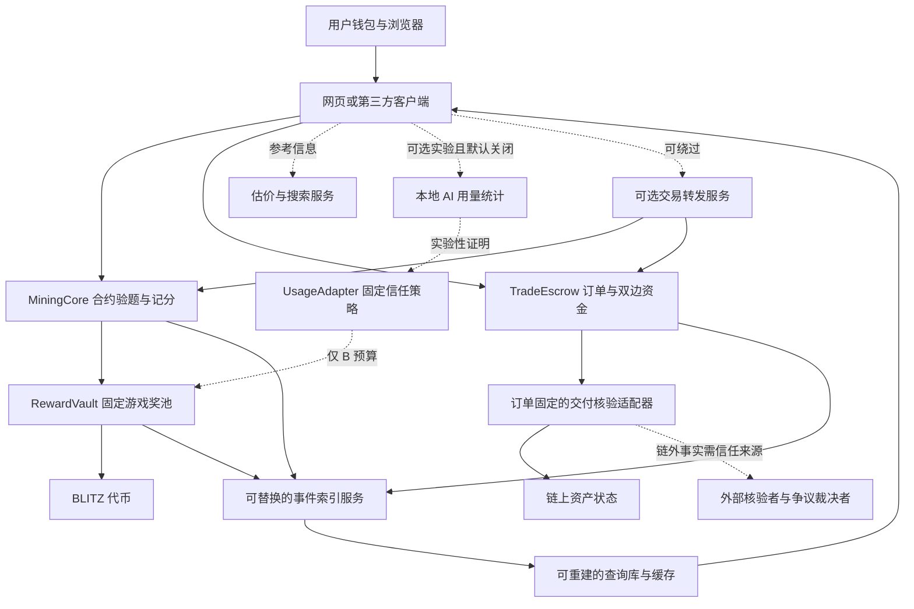

# 完整架构 v0.2：可验证贡献与通用担保交易

日期：2026-10-17。状态：设计，未编写应用或合约代码，未部署、压测或审计。

## 1. 产品边界

一个入口，两个独立业务：

- 千枚矿场：按有效贡献分配固定总量 1000 BLITZ，A 800 / B 200。
- 通用担保交易：确定的买家购买确定的商品；买家货款与卖家押金分别托管，按交付、保护期和争议规则结算。

交易不产生新 BLITZ，不从挖矿奖池支付赔偿，不因成交量产生额外挖矿奖励。没有随机赢取商品、代币兑换所、跨链桥或真实法币收单。

通用性来自共同订单和清晰的品类适配接口，不表示首版已能核验任何商品。首版证明链上资产路径；游戏皮肤、实物、数字服务保留扩展接口，未具备可靠核验前不开真实交割。

## 2. 三项要求与可观察标准

| 要求 | 本项目落实方式 | 以后必须验证 |
| --- | --- | --- |
| 去中心化 | 自托管钱包、合约托管、A 合约验题记分、公开条件、任何人可触发到期操作 | 关掉平台服务后，用户仍能直接访问合约关闭轮次、领取和执行约定退出 |
| 可扩展性 | 资金核心小而固定；品类接适配器；查询可横向扩展；结算不遍历全部用户 | 用户增多不增加单笔关闭轮次的遍历量，批量有界，性能与费用有实测 |
| 安全性 | 资产隔离、逐笔守恒、签名域与 nonce、最小权限、失败与争议规则 | 无增发、无越权提款、无重复领取/支付、无跨订单或跨链重放 |

Monad 提供底层账本与交易执行；应用仍需自己保证合约权限、输入真实性、数据可用性和前端安全。不能把链的宣传吞吐量当作应用压测结果。

## 3. 总体结构

实线不代表资金可以任意跨模块流动；RewardVault 与 TradeEscrow 必须是分离的资金责任边界。图中为逻辑组件，实际部署应避免为了分层创建不必要的合约。

## 4. 链上核心职责

| 组件 | 拥有的状态与职责 | 明确禁止 |
| --- | --- | --- |
| BLITZ | 固定供应与标准余额转移 | 后台增发、转账税、隐蔽升级改总量 |
| RewardVault | A/B 预算、开放轮预留、已关闭奖励、领取记录 | 管理员提走奖励、把 B 预算转给 A、给交易垫资 |
| MiningCore | 公开挑战、有效答案、重复检查、贡献区间、轮次关闭 | 接受后台任意上传的 A 积分表 |
| UsageAdapter | 仅实验实例的固定证明策略、记录去重、B 贡献区间 | 宣称本地自报等于可信算力、影响 A |
| TradeEscrow | 标准订单、双方入金、可领取余额、保护期、取消和争议 | 任意地址改收款人、重分配其他订单的钱 |
| 交付适配器 | 仅判断该订单约定的交付事实 | 任意提款、任意调用、改订单金额 |
| 实例/适配器目录 | 记录地址、版本、代码指纹与能力声明 | 给既有订单热替换核验规则 |

原 v0.1 中心裁判不再决定 A 的答案、积分和结算。关轮与按规则支付均由调用者发交易触发，智能合约不会仅凭时间流逝自动发送交易；自动执行服务是便利设施，可由任何人替代。

## 5. 去中心化按能力区分

| 能力 | 目标保证 | 仍依赖什么 |
| --- | --- | --- |
| A 贡献与领取 | 答案链上验算，公开状态可独立重建，平台不能伪造积分 | 链正常出块、RPC 可用、用户承担交易确认与费用 |
| 链上资产交割 | 核验资产、收款对象和入金均由同链合约执行 | 所接资产合约本身的安全性及不可变约束 |
| 链外商品交割 | 固定核验来源、固定争议策略与退出条件 | 平台/物流/服务方数据以及所选核验者诚实可用 |
| 估价 | 公开来源、时间、币种、匹配属性和置信程度 | 市场数据质量；仅供双方参考，不自动强制改价 |
| B AI 用量 | 预算隔离；没有可信来源时不开放 | 即使验签，也依赖证明方没有伪造原始用量 |
| 前端与查询 | 开源、可镜像、可直连合约；查询库可重建 | 浏览器、镜像/RPC 可达；单一官网不是协议唯一入口 |

多签降低单钥匙风险，不自动等于去中心化。多名核验者若都由同一方控制，或都依赖同一个错误源，也不能被描述为独立可信来源。

## 6. A 的完整数据流

1. 用户从合约获取时间窗口、种子、难度、规则版本及预算，任何人可在窗口内开启轮次。
2. 浏览器明确征得同意后进行本地计算；本地速度和动画不构成奖励凭据。
3. 正确答案直接或经可选转发服务上链；合约验算，记录归属钱包、积分区间与唯一答案。
4. 截止后任何人可关闭轮次，冻结最终总积分，无需裁判批准。
5. 玩家凭已记录的贡献编号分批领取，区间差额公式精确分完每轮预算，详见 [分配规则](TOKENOMICS.md)。

首版逐答案链上验证，明确付出存储与交易费成本；不靠引入新的中心裁判换取表面高吞吐。后续若用批量证明，必须证明完整计分规则、提供所需数据并处理漏记与退出，不能只放一个 Merkle 根就宣称真实性得到证明。

每轮共享累计积分会形成共享状态写入热点；O(1) 状态更新只说明算法不会遍历全场，不保证无限吞吐或所有矿工交易都能并行。应实测后再考虑可验证的分区汇总，不在比赛版自建 Rollup。

## 7. 通用交易数据流

1. 卖家发布标准商品描述，估价服务提供可追溯参考。
2. 买卖双方以钱包签名确认同一份完整订单，选择支付资产、核验适配器、所有期限、争议裁决者与失联后的固定结果。
3. 合约收到买家 P 与卖家 P；链上商品还需进入指定交割合约。任何一方未完成入金，按资金期限退出。
4. 交付事实满足订单规则后，卖家自己的 P 记为可领取；买家 P 继续托管。
5. 保护期结束且满足最终核验、没有未解决争议，买家 P 记为卖家可领取。撤回或失败时按规则退款。
6. 卖家总共取回 2P，其中只有 P 是成交收入。所有到账状态以链上交易成功为准。

链上商品首版采用不可回滚的同链交割和零保护期，可在一笔交割交易中完成资产转移与双方资金记账。链外商品的「快速」只意味着匹配/入金/交付反馈快，不承诺消除外部保护期或争议时间。

完整状态和资金规则见 [交易协议](TRADE_PROTOCOL.md)。

## 8. 链下与本地组件

| 组件 | 保存/处理什么 | 失败时的影响 |
| --- | --- | --- |
| 网页/备用客户端 | 钱包交互、动画、订单签名、规则展示 | 可换客户端；不能修改链上已确认事实 |
| Indexer | 合约事件、块号、交易哈希、重组处理 | 榜单/历史延迟，用户仍能直接读合约 |
| 查询库/缓存 | 订单筛选、排行榜、检索结果 | 可从事件重建金融状态，不保存用户私钥 |
| 估价服务 | 来源与时间戳、报价、属性匹配 | 无报价时暂停自动估价，仍可双方确认价格 |
| 转发/自动执行 | 帮用户提交原始贡献、到期操作 | 用户可自行提交；不拥有额外积分或提款权 |
| 外部核验器 | 经订单约定的交付/撤回/最终事实证明 | 外部品类进入争议或超时策略，不能假装自动成功 |
| 本地统计助手 | 明确选择的用量字段、基线与增量 | 仅影响实验 B，不影响 A 或交易资金 |

公开数据应可分页导出，索引事件要记录最终确认状态和可恢复游标。订单双方保留完整签名条款副本；证据正文采用授权访问与备份，摘要可校验完整性，但摘要不能还原丢失证据，也不证明证据真实。

## 9. 标准数据与接口约定

- 所有跨模块记录携带链 ID、实例/订单 ID、规则版本；不能只靠自增数字区分不同部署。
- 钱包签名采用 EIP-712 可读结构；另外实现 nonce、有效期和链上已使用/已取消状态，EIP-712 本身不提供防重放。
- 兼容智能合约钱包时核验 ERC-1271；不能只假设所有钱包都由一个普通私钥控制。
- 统一金额用资产最小单位整数表示，明确资产地址与精度，不把人民币参考报价直接当 MON 或 BLITZ 数量。
- 适配器返回固定事实类型与绑定证据，不返回任意「给谁转多少钱」指令；付款由 Escrow 固定规则决定。
- 矿场接口围绕轮次/挑战/贡献/领取；交易接口围绕报价/签署/入金/交割/争议/结算。接口需幂等、分页和明确错误状态，当前不定义实现代码。
- 平台登录只服务于偏好和非关键资料，不能成为链上领奖、退款和已签订单执行的唯一门槛。

## 10. 可扩展性策略

协议计算：每次 A 验证、关闭轮次、单条奖励计算、单订单状态变更均有界；批次长度和证据尺寸设置上限，不循环全体用户或全部订单。

服务承载：搜索、估价、索引、通知独立运行与扩容；缓存仅作查询，不作为资金事实源。RPC 可配置多个来源，对关键状态做链 ID 与确认检查。

业务扩展：新增品类实现规范化商品身份、估价、交付事实与争议策略；已有订单固定版本，新规则只对新订单/实例生效。插件不可通过 delegatecall 获得托管资金权限。

链上持久状态随贡献和订单数量增加，不因索引分页就消失；不作无限免费存储承诺。未来扩展需同时量化存储、验证、数据可用性和用户退出成本。

## 11. 权限、部署与运维

- 游戏核心与已有订单规则不可升级；新版本部署新实例，旧实例的领取与已约定退出路径保留。
- 已有订单固定适配器与裁决者，选择的实现不能靠可升级代理静默换代码；首版仅接已核对的不可变适配器。
- 项目管理权限只涉及发布目录、可选服务和停止新增业务入口；必要权限使用独立持有人多签，新增版本提前公开。
- 多签不能任意更改旧订单收款人、改总量、转走奖池、暂停全部既有退出或替换旧订单核验者。
- 非升级设计发现漏洞时可能无法修复原实例，不设置可抽走用户资金的「救援后门」来假装解决这个取舍。
- 前端静态部署必须满足入口与版本检查不缓存、资源内容哈希、失效分块可恢复，并验证旧标签页自动切换到新构建。
- 监控链上余额与负债、失败交易、RPC/索引滞后、贡献截止、未关闭轮、超时订单、外部核验延迟；告警不能直接变成越权转账。

## 12. 首版与后续路线

| 阶段 | 范围 | 不能宣称 |
| --- | --- | --- |
| 设计阶段：当前 | 文档、规则、架构、威胁与验收计划 | 已实现、已安全、已经支持真实交易 |
| 比赛核心 | A 链上验题领取 + 单一测试支付资产 + 测试 ERC-721 同链交易 | 链外商品已可靠交割、全部品类已支持 |
| 实验扩展 | B 用量统计演示，链外事实与争议模拟 | 自报用量真实性、模拟证明为真实交付 |
| 生产前 | 外部数据与裁决落地、故障演练、性能评估、独立审计、相应运营规则 | 仅凭代码开源即可托管真实资金 |

吞吐、手续费和外部核验可靠性均未实测。验收要求见 [安全模型](SECURITY_MODEL.md) 和 [交付计划](DELIVERY_PLAN.md)。

## 13. 依据

- [Monad 文档](https://docs.monad.xyz/)：EVM 开发与底层网络能力。
- [扩展性](https://ethereum.org/developers/docs/scaling/) 与 [链外事实/预言机问题](https://ethereum.org/developers/docs/oracles/)。
- [EIP-712](https://eips.ethereum.org/EIPS/eip-712)、[ERC-1271](https://eips.ethereum.org/EIPS/eip-1271)、[ERC-721](https://eips.ethereum.org/EIPS/eip-721)。
- [OpenZeppelin 权限控制](https://docs.openzeppelin.com/contracts/5.x/access-control)：最小权限、多签和延时管理参考；引用不是对本项目的审计或背书。
