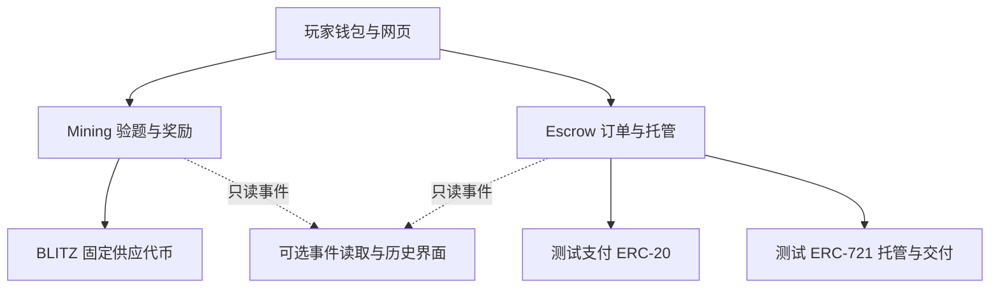

# 完整架构中文导读 v0.5

日期：2026-10-17。当前仅设计文档，没有应用/合约实现、部署、性能数据或审计结论。

本文与 [v0.5 比赛架构全文](ARCHITECTURE_v0.5_hackathon.md)、[分币规则](TOKENOMICS.md)、[交易协议](TRADE_PROTOCOL.md) 同步，替代 v0.2 的比赛实施范围。旧版本可从 Git 历史查阅，不把新旧规则并列为现行规则。

## 1. 一套入口，两个独立模块

千枚矿场提供链上验题、贡献计分与固定奖励；担保交易提供同链测试 NFT 的真实托管、双边入金、交付与超时退出。游戏与交易资金隔离，不因交易额额外发币。

首版不接真实皮肤、实物、AI 用量奖励、自动估价和人工争议。保留通用交付接口的行为设计，但当前只有 ERC-721 托管一种实现；未来链外品类需要新协议实例和完整的核验/争议规则，不是给不可升级旧合约换一个插件。

## 2. 三项要求如何落实

| 要求 | 当前设计 | 后续验收 |
| --- | --- | --- |
| 去中心化 | 钱包自托管；合约验证 A 的答案；任何人开/关轮、按条件完成/退出订单 | 关闭项目网页/查询服务后，用户仍能直接读合约和行使既有权利 |
| 可扩展性 | 三核心、有界操作、按贡献领取；查询服务可选；保留交付规范 | 关闭轮次不遍历全部玩家；批量受限；实测共享积分热点与费用 |
| 安全性 | 固定供应、资金隔离、完整签名域、状态/时间互斥、退款和 NFT 取回解耦 | 无越权改收款人、重复付款、预算超发或跨实例重放 |

上链不自动保证应用安全；开源不等于审计。首版不引入人工裁判，未来链外事实依然存在可信来源问题。

## 3. 组件图

Mining 和 Escrow 不互相调用、不共享资金；它们正常调用资产合约。NFT 安全转移可能调用买家/卖家的接收回调，因此不是“结算没有外部调用”。付款采取可领取余额，不在订单结算时向任意地址推送支付币。

## 4. 三核心职责

| 组件 | 职责 | 禁止 |
| --- | --- | --- |
| BLITZ | 初始化发行 1000，标准余额与转账 | 初始化后增发、开放销毁、税费、升级 |
| Mining | 持有 1000，A 预算上限 800，B 锁定 200；开轮、验题、区间、闭轮、领奖 | 后台填积分、管理员取走奖励、启用或迁移 B |
| Escrow | 双方签署订单、准确收款、NFT 托管、原子交付、退款、独立提现与取回 | 改旧条款/收款人、挪用其他订单资金、人工裁决 |

核心不可升级，不设置任意提款救援入口；因此错误可能无法在原实例中修复。测试支付币与测试 NFT 属于经过核对的演示资产，不支持任意恶意代币。

## 5. 游戏链路

1. 没有未关闭轮次且 A 有效轮少于 100 时，任何人可开轮，预留 8 枚。
2. 截止为开轮链上时间加固定轮长：演示实例 60 秒、普通实例 300 秒。关闭后才能再开下一轮。
3. 浏览器经用户同意计算 SHA-256；输入绑定链、实例、轮次、种子、钱包、nonce。难度暂定 16 位且部署后固定。
4. 每个链上接受的有效答案 1 分；多余前导零不加分。仅发给后台或仍待打包不算已接受。
5. 截止后任何人关轮；空轮返还预留，不耗有效轮。非空轮消耗一个名额，按区间累计差额精确分配 8 枚。
6. 按贡献编号独立领取；领取不依赖平台私有证明，收款人为记录中的钱包。

种子按开轮前一区块哈希及实例/轮次域固定，存在区块生产者与开启时机影响，不声称无偏随机，不用于随机奖品。所有提交仍写本轮总积分，是共享状态热点；存储打包不消除该热点。

## 6. 交易链路

1. 买卖双方签署相同完整订单：商品、双方、价格 P、资产、期限、链/合约/版本、nonce。
2. 创建时要求 `当前时间 < 入金截止 < 交付截止`。默认入金窗口 10 分钟，交付截止为入金截止后 5 分钟，双方签署绝对时间。
3. 双方各交 P；卖家还需把指定 NFT 实际放入本订单托管，授权不算已托管。
4. 完整入金且未到交付截止，任何人可完成交割：NFT 转买家、卖家记为可领取 2P；任一步失败，整个完成操作回滚。
5. 未入齐且入金超时，或已入齐但交付超时，任何人可退出，分别给原出资方记退款。
6. 退出不调用 NFT 返还；原卖家另行取回 NFT，可选择非零且非 Escrow 的接收地址，或签署绑定该次取回的授权。失败保留取回权，不影响资金提现。

首版保护期为 0；2P 包括卖家自己 P 的退回与 P 货款，没有随机商品归属。未来链外商品才考虑保护期、最终事实证明与争议。

## 7. 数据与接口边界

- 链上：轮次、贡献、领取标记、订单条款/资金角色、NFT 归属预留、退款权、取回权与签名使用/取消状态。
- 链下：网页、浏览器计算、可选历史事件读取。查询数据可从链上重建，不拥有资产决定权。
- 所有金额使用最小单位整数；资金成功到账与仅记为可领取分别展示。
- 回调、输入和批次有界；不遍历全部历史订单或玩家，不使用可热替换适配器绕过不可升级承诺。
- 同一 NFT 不能归属两个活动订单。退款终态不重开，但可领取余额与 NFT 取回权继续有效。
- 没有平台强制登录才能提现的条件。合约交互说明与备用客户端属于后续交付，不代表当前已有可运行界面。

## 8. 资产和扩展边界

当前 Mining 初始化接收 1000 BLITZ，最多支付 A 的 800。B 无执行/迁移/救援路径，其 200 永久留在当前实例。未来新实例的新发行不是迁移原有 200，也不能说成同一个全局 1000 总量资产。

拓展估价、链外商品、B 和运营权限时，另设计新版本并公开其资产来源、证据、退出与治理规则。旧订单和旧奖励不被后台静默升级。

## 9. 尚未验证

起始难度、提交/关闭/领取 gas、备用 RPC、时限流程和实际并发仍未测。主 RPC 此前成功核对链 ID，不表示持续可用保证。官方网络吞吐量不是应用实测。

前端未来发布还必须验证入口/版本不缓存、资源内容哈希、失效分块恢复，以及旧标签页自动切换新构建。

详见 [安全模型](SECURITY_MODEL.md) 与 [交付计划](DELIVERY_PLAN.md)。
