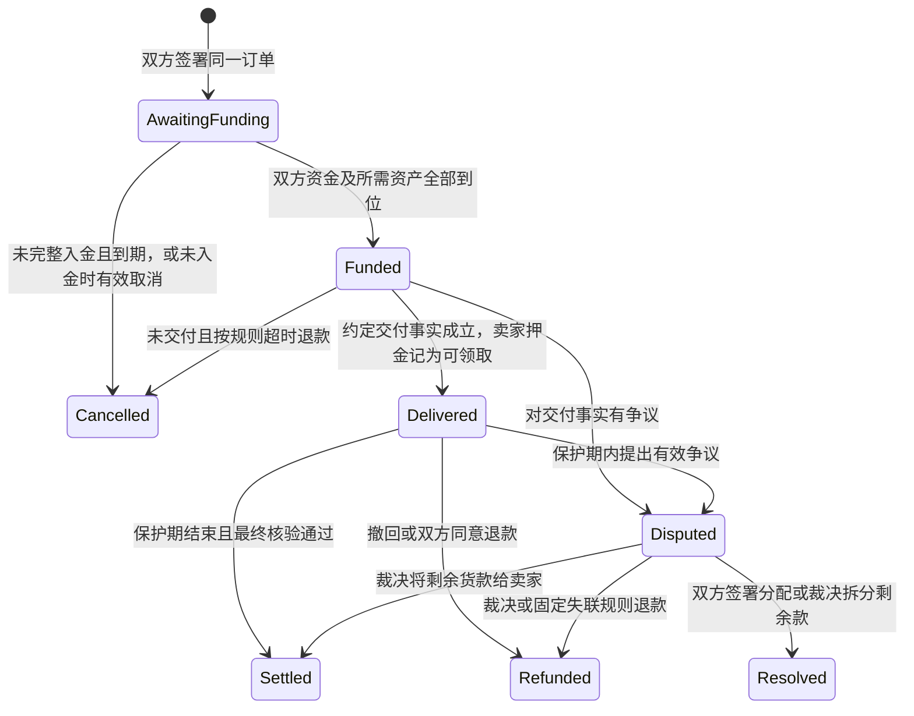

# 通用担保交易协议 v0.2

日期：2026-10-17。状态：方案，没有交易合约或真实商品接入。交易为确定买家、确定价格的买卖，roll 若作为展示动画，不影响商品归属与结算。

## 1. 用户确认的资金规则

成交价 P，买家交 P 货款，卖家交 P 押金，共 2P。核验商品交付后，卖家自己的 P 立即变成可领取；买家 P 留在托管中，满足保护期与最终核验后再给卖家。

正常结束：买家花 P 得商品；卖家收到 2P，其中 P 是取回自己的押金，P 是卖货收入。手续费由发交易的人承担，不悄悄从 P 中扣除。首版平台费用为 0。

「立即返回」是交付被合约确认后立即具备领取权，实际到账仍需领取交易成功。不得提前说已经转账。用户也可授权固定收款地址的代触发领取，但代触发者不能改收款人。

## 2. 通用订单最少包含什么

| 字段组 | 必须确定的内容 |
| --- | --- |
| 身份 | 链 ID、协议合约、规则版本、唯一订单 nonce、买家、卖家；首版不支持同一地址同时充当双方 |
| 商品 | 类别、规范商品标识、数量、属性摘要、描述版本；链上商品还包括合约地址与 token ID |
| 金额 | 支付资产、整数最小单位成交价 P、卖家押金 P、费用为 0 |
| 估价 | 可选报价摘要、来源、采样时间、报价币种、匹配属性与过期时间；不能代替双方确认价 |
| 核验 | 固定交付适配器地址与代码/版本、事实来源、核验权限及证据格式 |
| 时间 | 入金截止、交付截止、交付证明截止、保护期计算方式、最终核验截止、争议与裁决截止 |
| 争议 | 固定裁决者/阈值、证据提交方式、可分配资金范围、裁决失联时的确定结果 |
| 授权 | 双方对相同完整条款签名、签名有效期、使用与取消状态 |

付款前展示全部期限与失联风险，不允许用「默认条款以后再填」接受资金。双方签署后只能取消并新建订单，不能平台单方面改价、改裁判或缩短保护期。

未来可以有不同押金比例的新版订单，但 v0.2 采用用户已确认的 1:1，不在运行中自动调整。

## 3. 自动估价

输入规范商品身份与属性，查询可获得且允许使用的市场数据，输出参考区间、币种、来源与更新时间；成交价必须双方确认。

同名不同属性不能直接算同一种商品；挂单价不能冒充已成交价，Steam 账户内价格也不能不经说明当作现金价格。稀有品、缺样本、来源冲突或数据过期时显示「无法可靠估价」，允许协商价，不编造唯一公允价格。

源站不提供接口或限制访问时不绕过限制。任意用户提供的商品链接不能由服务器直接无约束抓取，需防止访问内网、云元数据或恶意超大内容。

价格服务不能直接触发扣款。参考报价过期影响签约前的报价可用性，不改变已经签订的成交价；付款资产与外币参考价之间的换算必须双方明确确认，首版仅用单一测试支付资产演示。

## 4. 核心状态与动作

状态名是设计约定，不是当前接口。所有转移只能执行一次，领取余额与订单阶段分开记录；订单状态完成不代表所有人已经把钱提走。

## 5. 各阶段的执行规则

### 5.1 签约与入金

- 同一份条款双方签署才有效；EIP-712 之外还需要链 ID、合约域、nonce、到期、已使用/已取消记录防重放。
- 只接受双方各自应付的准确金额，记录每一方所有权；不使用任意充值余额随意挪账。
- 首版只支持一个经过核对、无转账税/重基准/可变扣款行为的测试支付资产，不支持任意恶意 ERC-20。资金使用最小授权，不索取钱包私钥。
- 链上商品由卖家先放入指定交割托管，核验商品与订单一致；买家入金前可以检查资产已就位。
- 未完整入金且入金期限已到，任何人可触发取消：已经入金的钱分别归还原出资方，已经托管的商品归卖家。
- 一旦完整入金，不能借「撤销签名」单方面跳过交付/争议流程。

### 5.2 交付与押金返回

- 只有订单固定的事实规则可以把状态改成 Delivered；卖家单方面点「已发货」不够。
- 链上资产首版由同链合约执行转移，交易失败则资产转移、状态和资金记账整体失败，不退押金。
- 链外商品依赖事先约定的核验者或双方共同确认。未实现并验证接入前，这类订单不接受真实资产入金。
- Delivered 后卖家押金 P 记为可领取，买家货款 P 仍锁定；不能同时把 2P 全放给卖家。
- 押金退回后无法再罚没或追回，默认不能补偿买家等待、时间成本或商品价格变化。

### 5.3 保护期与最终付款

- 保护期按品类与订单约定，不写死全场七天。链上不可撤回交割的首版示例保护期为 0。
- 对 CS2 等可撤回外部交易，最终期限应依据平台实际保护状态；参考时长不能代替最终核验。
- 在保护期 `[交付确认时刻, 保护结束时刻)` 内接受符合订单条件的争议；边界和链上纳入时间需付款前说明。
- 保护期结束不等于外部商品自动最终交付。链外路径需要在最终核验期限内拿到绑定该订单的最终事实证明，且没有未解决争议。
- 条件具备后任何人可触发将 P 记为卖家可领取；无需平台人工提款审批。
- 链上路径条件均可在合约内判断。外部路径是否满足条件仍依赖来源与证明者，不能宣传为同链原子交换。

### 5.4 失败、撤回与争议

- 可证明未交付或平台确认撤回时，将仍托管的买家 P 退给买家，不能同时给卖家同一份货款。
- 商品未交付时取消，卖家押金按首版规则返还卖家；首版不另设自动罚款。若以后引入违约罚款，须另建条款版本双方预先同意。
- 商品已经交付时，不能仅凭买家单方面不满意就自动退款；交付质量和退货条件依商品类型与争议规则处理。
- 争议期间只冻结该订单未分配金额，不冻结其他订单或游戏奖励。
- 双方可以共同签署一次性和解分配；签名覆盖剩余金额、双方收款地址、订单版本和 nonce。
- 外部裁决只能在事先指定的剩余资金内分配，买方份额与卖方份额之和恰好等于可裁决余额；不能动已退押金、其他订单或游戏金库。
- 裁决者不能由平台在争议发生后随意替换；独立持有人多签可降低单人风险，但仍有串通、错误与停机风险。

## 6. 不允许资金无限悬挂：必填超时策略

| 情况 | 到期后动作 |
| --- | --- |
| 只收到一方资金或商品 | 取消，原路建立各自退款/返还权 |
| 已完整入金，链上资产交付未执行 | 交付期限后取消，分别返还资金与托管资产 |
| 链外已有交付争议，无法自动判断 | 进入事先选择的裁决路径，不能用后台沉默当作核验成功 |
| 已交付但最终证明缺失 | 进入争议，不自动放款给卖家 |
| 裁决者到期仍未处理 | 执行签约时固定的 fallback 分配；任何人可触发 |

首个链外实验模板的 fallback 为：尚锁定货款 P 退买家，尚未退的卖家押金归卖家。但这可能让已真实交货的卖家损失商品，尤其对无法强制退回的实物/数字服务；必须由卖家付款前明确接受。它是终止资金悬挂的风险分配，不是交付真实性证明，也不保证双方绝对公平。

无法接受这种失联结果的品类不得使用该模板，不靠无限延长锁款掩盖未解决问题。实际链外接入和可接受的裁决体系未确定前，首版不开放这些真实订单。

退款不等于外部商品已经退回。商品退回、部分交付、质量争议、运费税费等需要独立品类规则；不能拿统一按钮宣称全部解决。

## 7. 资金算例与守恒

以下 100 指 100 个约定测试支付单位，不是人民币、MON 或 BLITZ 的自动等值换算。

| 阶段 | 累计实际支付/退款 | 已记可领取 | 仍锁定 | 合计 |
| --- | ---: | ---: | ---: | ---: |
| 双方各入金 100 | 0 | 0 | 200 | 200 |
| 确认交付，卖家押金可领取 | 0 | 卖家 100 | 买家货款 100 | 200 |
| 卖家领取自己的押金 | 卖家 100 | 0 | 买家货款 100 | 200 |
| 最终交付成立，货款可领取 | 卖家 100 | 卖家 100 | 0 | 200 |
| 正常全部领取 | 卖家 200 | 0 | 0 | 200 |

若在退押金后确认撤回：卖家已拿回自己的 100，剩下 100 给买家退款；双方资金净损益为 0（不含手续费），外部商品是否回到卖家以平台实际结果为准。

任意阶段按订单及支付资产核对：`累计实际支付/退款 + 已记可领取 + 仍锁定 = 累计有效入金`。

首版不收平台费；未来版本若引入费用，需单独预算项并在签约前披露。外部误转、强制转入、资产价格变化不能增加该订单的可分配负债。

## 8. 品类扩展与发布标准

| 品类 | 商品身份 | 核验方式 | 首版状态 |
| --- | --- | --- | --- |
| 同链测试 ERC-721 | 合约 + token ID | 合约内资产托管与转移 | 比赛必做路径，尚未实现 |
| 其他链上标准资产 | 合约 + 标准 + 数量 | 对应标准适配器与资产限制 | 后续扩展，不自动支持所有代币 |
| 游戏皮肤 | 平台 + 精确物品/交易标识 | 平台交付、撤回及保护状态 + 固定证明方 | 设计接口，不接真实资产 |
| 实物 | 规格 + 订单/物流标识 | 收货、退货与品类争议裁决 | 设计接口，不接真实资产 |
| 数字商品/服务 | 交付物摘要 + 验收要求 | 双方验收或约定裁决 | 设计接口，不接真实资产 |

适配器只输出限定事实：已交付、已撤回、最终完成或有争议，携带实例、订单、来源、时间、证据摘要和签名域。它不能返回任意提款指令，也不能经 delegatecall 控制 Escrow。

新增适配器需明确证据可用性、独立性、可回滚性、失败策略和资金影响；旧订单绑定的版本不变。未来多个独立核验者的阈值证明仍需考虑共同数据源故障，不当作数学证明。

## 9. 依据及关联文档

- [完整架构](ARCHITECTURE.md)、[安全与验收](SECURITY_MODEL.md)。
- [EIP-712](https://eips.ethereum.org/EIPS/eip-712)、[ERC-1271](https://eips.ethereum.org/EIPS/eip-1271)、[ERC-721](https://eips.ethereum.org/EIPS/eip-721)。
- [Steam Trade Protection](https://help.steampowered.com/en/faqs/view/365F-4BEE-2AE2-7BDD)：当前 CS2 的受保护交易有撤回窗口；接入时必须再次核对实际规则。
- [预言机问题](https://ethereum.org/developers/docs/oracles/)：链外事实的正确性和可用性需要单独解决。
