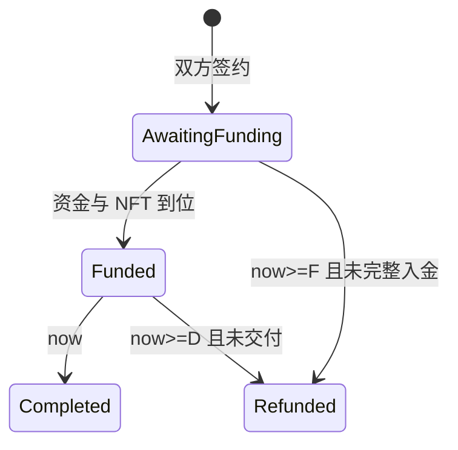

# 担保交易协议 v0.5

日期：2026-10-17。架构设计，未实现、部署或接入真实商品。当前规范与 [v0.5 全文](ARCHITECTURE_v0.5_hackathon.md) 一致。

## 1. 当前范围与资金

仅同链测试 ERC-721 换单一测试支付 ERC-20。保护期 0，没有人工裁判。买家确定拿商品，不存在随机归属。

成交价 P>0；买家交 P 货款，卖家交 P 押金并实际托管 NFT。成功交割在同一交易中转 NFT 给买家、给卖家记 2P 可领取；失败整体回滚。卖家领取的 2P 中只有 P 是成交收入，另一 P 是押金退回。

资金采用主动提现。记为可领取不等于交易已经到账；订单结算不推送支付币，但 NFT 转移有外部调用和接收回调，必须处理重入与拒收。

## 2. 双方签署的完整订单

签名绑定买家、卖家、测试支付资产、整数最小单位 P、NFT 合约/tokenId、所有截止时间、链 ID、Escrow 地址、协议版本、nonce 与固定退款规则。签名采用 EIP-712 可读结构，并另外维护使用/取消状态；同一授权不能重新创建或复活订单。

创建时要求 `now < fundingDeadline < deliveryDeadline`。默认签约时间下入金截止 10 分钟后，交付截止为入金截止再加 5 分钟；绝对时刻由双方签署，不能后台单方修改。时限默认值尚未实测。

未入金订单可按协议取消；只入一方后不能通过取消签名绕过退款规则。终态不能重开，但退款/收入提现与 NFT 取回权继续有效。

## 3. 真实托管与入金

- 买家只交自己的 P 一次，卖家只交自己的 P 一次；资产地址和实际到账金额必须核对。
- 卖家入金与指定 NFT 转入托管绑定；授权或 ownerOf 显示 Escrow 持有，都不能单独代替本订单接收与归属记录。
- 同一个 NFT 不能同时归属两个未完成/尚待取回的订单；已退款但仍等待取回的 NFT 仍保留原订单归属。
- 首版只接经过核对的测试支付币/测试 NFT，不支持任意重基准、转账税或恶意回调资产。
- 定义 fullyFunded：双方应付款均已记录、指定 NFT 已正确归属本订单并在托管中。

## 4. 行为与时间条件

| 动作 | 谁可触发 | 条件 | 结果 |
| --- | --- | --- | --- |
| 创建 | 任一方，携带双方完整签名 | 授权未用/未取消，P>0，双方及资产正确，now<F<D | 固定条款并消费该订单授权 |
| 买方/卖方入金 | 对应出资方 | 非终态，本方未入，now<F；卖方还需正确 NFT | 仅记本方准确资金与托管，不重复入金 |
| 完成交割 | 任何人 | fullyFunded，非终态，now<D | 原子交 NFT 给固定买家，卖家记可领取 2P，订单完成 |
| 入金超时退出 | 任何人 | 未 fullyFunded，非终态，now>=F | 订单退款终态，实际入金分别记给原出资人 |
| 交付超时退出 | 任何人 | fullyFunded 但未交付，非终态，now>=D | 订单退款终态，各自 P 记为可领取 |
| 提现 | 对应余额所有者 | 有可领取余额，未重复消耗 | 支付币转原余额所有者，不改订单收款人 |
| 取回退款 NFT | 原卖家或持有具体授权的调用者 | 退款终态、原订单 NFT 仍持有、取回权未消费、接收地址有效 | 单独转 NFT，成功后消费取回权 |

F 为 fundingDeadline，D 为 deliveryDeadline。完整入金后，即使过了 F，只要 now<D，仍可交付，不能走入金超时取消。在恰好 F 时拒绝入金；恰好 D 时拒绝交付，允许相应退出。不能只比较时间而忽略订单状态。

## 5. 退款与 NFT 取回解耦

超时退出先把订单标记为退款终态，并一次性记入双方可领取资金；这一步完全不执行 NFT 返还。若实际持有 NFT，建立归原卖家的待取回权。

原卖家可选择自己控制的有效接收地址，要求非零且不是 Escrow。其他人只有持有卖家对该次取回的具体授权才可执行，授权覆盖链、Escrow、版本、订单、NFT/tokenId、动作、接收地址、nonce 和有效期。

- 任何超时调用者不能替卖家选择接收地址，也不能改双方资金收款人。
- NFT 转移成功后，取回权只能被消费一次；失败则保持待取回，原资金退款不受影响。
- 接收方拒收后，卖家可选择另一个可接收地址重试。
- NFT 取回改变的是独立资产返还记录，不把订单从退款终态改回活动状态。
- 该设计消除对手拒收对付款退款的阻塞，不保证链故障、恶意资产或丢失私钥时任何资产都必然可恢复。

## 6. 状态图

Completed 和 Refunded 为订单阶段终态。资金提现、NFT 独立取回的状态另记，不让重复退出重新制造余额。NFT 安全转移失败不得留下 Completed 或卖家 2P 的可领取余额。

## 7. 资金算例与守恒

P=100 指约定的测试支付单位，不自动等于人民币、MON 或 BLITZ。

| 场景 | 原买家可领取 | 原卖家可领取 | NFT |
| --- | ---: | ---: | --- |
| 买家已入 100，卖家未入，F 到期 | 100 | 0 | 没有托管 NFT 则无取回权 |
| 双方各入 100，NFT 已托管，成功交付 | 0 | 200 | 固定买家获得 |
| 双方各入 100，交付未完成，D 到期 | 100 | 100 | 留在 Escrow，原卖家单独取回 |
| 上一场景 NFT 返还失败 | 100 | 100 | 仍待原卖家选择地址取回，不影响两笔提现 |

任意时刻按订单和支付资产核对：`累计实际支付/退款 + 已记可领取 + 仍锁定 = 累计有效入金`。平台费用为 0，手续费另由发交易的人承担。资金入金、可领取记账、实际提现严格区分。

NFT 与资金不同账本：只允许归属该订单、交给固定买家，或在退款后交给原卖家授权的接收地址；没有两个订单同时支配同一 NFT。

## 8. 后续通用交易方向

保留标准商品身份、估价、交付核验的接口设计。自动估价只是参考，价格仍由双方确认。链外皮肤、实物、服务需要可用的事实源、保护期、争议和失联策略，另建协议版本；不在当前零保护期且不可升级的实例热启用。

过去讨论的“交付后先退押金，保护期后再付货款”属于后续链外版本；本版保护期 0，所以在一次成功交割中记为卖家可领取 2P。已退押金不能假设未来还可罚没。

关联：[架构](ARCHITECTURE.md)、[安全](SECURITY_MODEL.md)、[交付计划](DELIVERY_PLAN.md)。参考 [EIP-712](https://eips.ethereum.org/EIPS/eip-712)、[ERC-721](https://eips.ethereum.org/EIPS/eip-721)。
